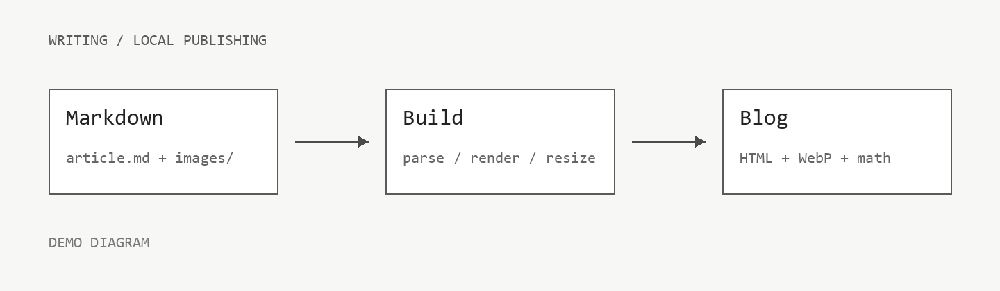

这是一篇**排版演示与写作示例**。文章信息和正文保存在同一个 Markdown 文件里，配图放在文章附近的独立目录中。你可以参考本篇的源文件写自己的博客。

## 在正文插入图片

使用标准语法 ``。下面的示意图存放在本篇文章旁的 `images/markdown-guide/` 目录中，构建时自动生成适合屏幕的 WebP 图片。



*示意图：从 Markdown 写作到博客页面。图片说明会作为替代文字保留。*

## 用表格比较方案

表头下方的冒号可以指定对齐方向。表格里可以使用**粗体**、`代码`、链接和公式。

| 内容 | Markdown 写法 | 展示方式 |
| :--- | :---: | ---: |
| 图片 | `` | 自适应宽度 |
| 行内公式 | `$E = mc^2$` | $E = mc^2$ |
| 代码 | 三个反引号与语言名 | 高亮并支持复制 |
| 长表格 | 标准管道表格 | 手机可横向滚动 |

## 数学公式

行内公式使用单个美元符号，例如 $E = mc^2$，以及算法复杂度 $O(n \log n)$。

独立公式使用两行 `$$` 包围。支持分式、求和、积分、矩阵和多行推导等常用 LaTeX 数学语法。

$$
\mathcal{L}(\theta) = \frac{1}{N}\sum_{i=1}^{N}\left(y_i - f_\theta(x_i)\right)^2
$$

$$
\begin{aligned}
\nabla_\theta \mathcal{L}(\theta) &= \frac{2}{N}\sum_{i=1}^{N}\left(f_\theta(x_i)-y_i\right)\nabla_\theta f_\theta(x_i) \\
\theta_{t+1} &= \theta_t - \eta\,\nabla_\theta\mathcal{L}(\theta_t)
\end{aligned}
$$

$$
A = \begin{bmatrix}1 & 2 \\ 3 & 4\end{bmatrix},\qquad
\int_0^1 x^2\,dx = \frac{1}{3}
$$

## 代码仍然按原样展示

代码中的图片语法、美元符号与竖线不会变成图片、公式或表格：

```python
message = ""
formula = "$E = mc^2$"
columns = "name | value"
print(message, formula, columns)
```

## 日常写作步骤

1. 复制博客模块 `templates/post.md`，放入 `content/posts/`，修改文件名和开头的文章信息。
2. 编写正文，把配图放到文章旁的 `images/你的文章标识/`。
3. 草稿保持 `draft: true`，使用本地草稿预览。
4. 完成后设为 `draft: false`，重新构建。

> 公式使用本地资源排版；无需第三方 CDN。文章、配图和排版文件都由博客模块独立维护。
